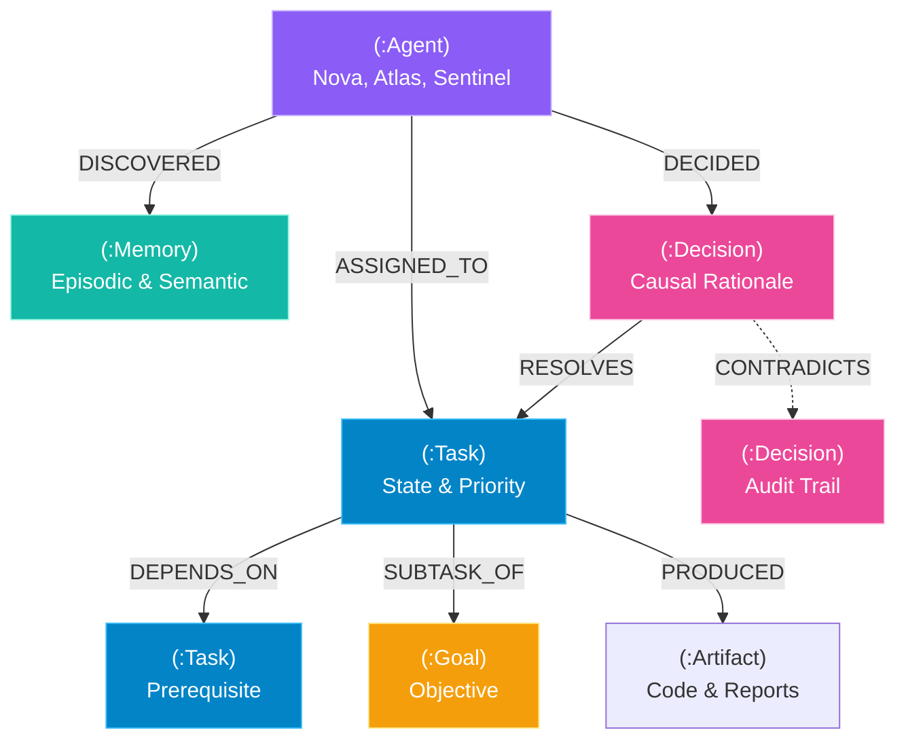

# AgentMesh AI 🕸️🧠
### Graph-Native Multi-Agent Memory & Context Coordination Engine
**Powered by [FalkorDB](https://www.falkordb.com/) — The Ultra-Fast Graph Database for AI Agents**

[](https://shivysidinfo.tech/agentmesh-ai/)
[](https://www.falkordb.com/)
[](https://www.python.org/)
[](https://fastapi.tiangolo.com/)
[](https://opencypher.org/)
[]()
[](docker-compose.yml)
[](LICENSE)


> **Official Submission for [Graph Hacks: Context for AI Agents](https://www.wemakedevs.org/hackathons/falkordb)**  
> Hosted by **WeMakeDevs** & **FalkorDB** (Oct 15–18, 2026)  
> *Tracks Entered:* **Track 01 (Agents That Act on Connected Data)** | **Track 02 (Agent Memory and Coordination)** | **Track 03 (Company Brain)**  
> *Author:* Sudhir Sharma ([@satanic47](https://github.com/satanic47))

---

## 🌟 Executive Summary & Motivation

### The Flaw with Flat Vector Memory
Modern autonomous agent frameworks (MemGPT, LangChain, AutoGen) attempt to manage memory by flattening conversations into text embeddings stored in vector databases. While vector search is effective for semantic similarity, it **fails catastrophically at multi-hop relational reasoning**:
1. **Loss of Causal Context:** Vector embeddings cannot represent causal chains such as: *"Agent Atlas executed Task B only because Agent Nova approved Decision A, which resolved Security Blocker C."*
2. **State Drift & Deadlocks:** In multi-agent swarms, agents communicate through lossy chat streams. Without a shared dependency graph, agents create circular dependencies, execute tasks out of sequence, or repeat work.
3. **Context Window Waste:** Flooding LLMs with raw message histories wastes tokens and degrades reasoning precision.

### The FalkorDB Solution
**AgentMesh AI** turns **FalkorDB** into the central nervous system for autonomous AI agent swarms:
* **Graph-Native Coordination:** Tasks, goals, prerequisites, and assignments form a directed property graph. Tasks become ready for execution **only when Cypher verifies all prerequisite subgraphs are resolved**.
* **Zero-Latency Multi-Hop Context Injection:** Instead of passing entire chat histories, agents query FalkorDB in `<2ms` to pull a **2-hop contextual neighborhood** (immediate prerequisites, prior rationales, institutional policies, and contradictory claims) directly into their reasoning prompt.
* **Real-Time Deadlock Prevention:** FalkorDB executes multi-hop Cypher path traversals (`(t:Task)-[:DEPENDS_ON*1..10]->(t)`) to detect cycles and unblock pipelines before execution failures occur.

---

## 📊 Graph Schema in FalkorDB



---

## 🚀 Key Features

### 1. Cypher-Driven Task Coordination (Blackboard Architecture)
Instead of polling a central supervisor, agents execute a single atomic Cypher query to retrieve tasks that are ready to run:
```cypher
MATCH (t:Task {status: 'pending'})
OPTIONAL MATCH (t)-[:DEPENDS_ON]->(dep:Task)
WITH t, count(dep) AS total_deps, count(CASE WHEN dep.status = 'completed' THEN 1 END) AS done_deps
WHERE total_deps = done_deps
RETURN t.id AS id, t.title AS title, t.priority AS priority
ORDER BY t.priority DESC, t.created_at ASC
```

### 2. 2-Hop Context Subgraph Extraction
Before an agent acts, FalkorDB extracts the immediate causal subgraph:
```cypher
MATCH (t:Task {id: $task_id})
OPTIONAL MATCH (t)-[:DEPENDS_ON]->(prereq:Task)
OPTIONAL MATCH (d:Decision)-[:RESOLVES]->(prereq)
OPTIONAL MATCH (a:Agent)-[:DISCOVERED]->(m:Memory)
RETURN t.title, collect(DISTINCT prereq.title), collect(DISTINCT d.outcome)
```

### 3. Circular Dependency & Deadlock Detection
Cypher multi-hop path matching detects circular blockages in real time:
```cypher
MATCH p = (t:Task)-[:DEPENDS_ON*1..10]->(t)
RETURN nodes(p) AS cycle_nodes, length(p) AS cycle_length
LIMIT 5
```

### 4. Interactive Real-Time Cyber Visualizer
* **Live Cytoscape.js Graph Canvas:** Visualizes nodes and relationships with real-time status transitions.
* **Interactive Cypher Console:** Run arbitrary Cypher queries with sub-millisecond execution telemetry.
* **Swarm Simulator:** Step through multi-agent task execution and observe graph state updates live.

---

## 🛠️ Quickstart

### Prerequisites
* Python 3.10+
* (Optional) Docker & Docker Compose for live FalkorDB instance

### Option A: 1-Click Launch with Docker Compose (Recommended)
Spins up both FalkorDB (`falkordb/falkordb:latest`) and the AgentMesh web platform:
```bash
docker-compose up --build
```
Open your browser at **`http://localhost:8000`**.

---

### Option B: Local Python Execution (Zero-Friction Fallback)
AgentMesh includes an embedded in-memory Cypher graph engine that runs out-of-the-box without Docker:
```bash
# 1. Clone the repository
git clone https://github.com/satanic47/agentmesh-ai.git
cd agentmesh-ai

# 2. Install dependencies
pip install -r requirements.txt

# 3. Start the application
python -m uvicorn app.main:app --host 0.0.0.0 --port 8000 --reload
```
Open **`http://localhost:8000`** in your browser to interact with the dashboard!

---

## 🧪 Running the Test Suite

AgentMesh includes a comprehensive test suite covering Cypher node and relationship creation, dependency resolution, deadlock detection, and API endpoints:
```bash
python -m pytest
```

Output:
```text
tests/test_api_endpoints.py ....                                         [ 44%]
tests/test_dependency_engine.py ...                                      [ 77%]
tests/test_falkordb_queries.py ..                                        [100%]
============================== 9 passed in 1.68s ==============================
```

---

## 🏆 Hackathon Tracks Justification

| Track | Why AgentMesh Wins |
|---|---|
| **Track 01: Agents That Act on Connected Data** | Agents do not operate on static records; they navigate graph neighborhoods, evaluate interconnected dependencies, and update shared state with every decision. |
| **Track 02: Agent Memory and Coordination** | Coordinates a 4-agent swarm (`Nova-Planner`, `Atlas-Engineer`, `Sentinel-Security`, `Chronos-Memory`) using FalkorDB as a persistent blackboard, preventing race conditions and deadlocks. |
| **Track 03: Company Brain** | Stores organizational decisions, architecture guidelines, and institutional memory in a persistent knowledge graph that spans across user sessions. |

---

## 📄 License
MIT License. Created for the **WeMakeDevs x FalkorDB Graph Hacks 2026**.
